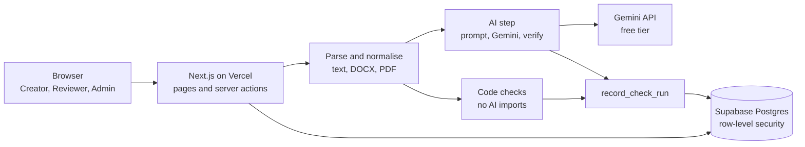

# Rulecite architecture

This describes the deployed product as of 2026-11-06. The reasons behind each choice are in [technical-decisions.md](technical-decisions.md).

## Overview

| Layer | Technology | Where |
|---|---|---|
| Interface and server code | Next.js 16 App Router, React 19, TypeScript, Tailwind 4 | Vercel, functions in `iad1` (United States) |
| Sign-in and data | Supabase Auth and Postgres | Singapore |
| AI | `gemini-3.1-flash-lite`, through `generateContent` | Google, free tier |

There is no job queue. A check runs inside the request, and the AI step has a 45-second default time limit.

## Code layout

| Path | Responsibility |
|---|---|
| `src/app/(app)` | Protected pages: workspace, documents, review, rulebook, ledger, assets, insights, audit, trust |
| `src/proxy.ts` | Refreshes sessions and redirects early. It is not the security boundary |
| `src/lib/auth` | `requireMember()`, role checks, sign-in and sign-out |
| `src/lib/analysis/intake.ts` | Parses text, DOCX and PDF in memory |
| `src/lib/analysis/deterministic` | Code checks, with no AI dependency |
| `src/lib/analysis/ai.ts` | Prompt, output schema and verification |
| `src/lib/analysis/run.ts` | Runs a check from start to finish |
| `src/lib/ai` | Provider interface, Gemini adapter and provider selection |
| `src/lib/documents` | Document actions, workflow actions and fix application |
| `src/lib/insights/gap-radar.ts` | Repeated problems and possibly unclear rules |
| `supabase/migrations` | Schema, row-level security, triggers and database functions |
| `tests/golden` | Labelled documents, scorer, saved responses and reports |

## How a check runs

1. **Intake.** The file is parsed in memory and never stored. Only the extracted text, image descriptions and colours are kept.
2. **Save.** `create_document()` or `add_document_version()` saves the content. It stays saved even if a check later fails.
3. **Code checks.** Approved rules and colours are loaded under the user's own permissions, and code checks run.
4. **AI gate.** The AI step runs only if the version is confirmed fictional, a provider is configured, AI-type rules exist and the organisation's daily limit allows it. The limit is reserved atomically in the database.
5. **AI request.** The draft, approved tone, messaging and claim rules, and approved facts that have started are sent to Gemini. Code marks expired facts, and the draft is framed as data, not instructions. One retry is allowed for temporary errors, inside the time limit.
6. **Verification.** The response must match the Zod schema. The quote must appear word for word, and the rule and fact must be ones that were sent. Other findings are dropped and counted. Offsets, severity and claim labels are set in code, never by the model.
7. **Record.** `record_check_run()` saves code and AI findings together, with a copy of each cited rule and fact, so findings stay readable if a rule later changes.

If the AI step fails, code findings are still saved and the run is `partial`, with the reason shown. If the whole check fails, the document stays saved and the page offers a rerun.

## Security model

| Control | How it works |
|---|---|
| Sign-in | `requireMember()` verifies the token signature and reads the role from the database. There is no public registration |
| Session | `HttpOnly`, `SameSite=Lax` cookie, and `Secure` in production |
| Authorisation | Row-level security, column grants and triggers. Frontend role checks are for display only |
| Writes | Clients cannot write directly to documents, findings or decisions. Each step is a checked database function |
| Faked results | `record_check_run()` needs a server-only secret, and only its hash is stored in the database |
| Audit | Database triggers write audit entries. The log is append-only, even for service-role connections |
| AI key | Read only on the server. Modules use `server-only`, and built browser files are scanned for secret values |
| Free-tier boundary | The server sends only content confirmed as fictional. This relies on the user's confirmation |

The running app does not use the Supabase service role key. That key is used only by local seed and test scripts.

## Main tables

| Group | Tables |
|---|---|
| Organisation | `organizations`, `memberships`, `audit_log` |
| Brand sources | `rules`, `rule_revisions`, `facts`, `fact_revisions`, `assets` |
| Content | `documents`, `document_versions`, `check_runs`, `findings` |
| Review | `finding_decisions`, `comments` |
| Private | `private.check_writer`, `private.ai_usage` |

## Reliability

- Code checks work with no AI key.
- Provider errors map to named reasons, and raw provider errors are not returned to users.
- A partial run never says "no issues found".
- `GET /api/health` reports database reachability and is never cached.
- Automated tests never call Gemini.

## Known architectural limits

- Every check waits for the AI step inside one request.
- Code and AI findings are saved together at the end of a check, so an unexpected crash during the AI step loses that run's findings. The document stays saved and can be rechecked.
- Functions run in the United States while data is in Singapore, which adds latency. The region can be changed in Vercel.
- Supabase Storage is not used, because uploaded files are not kept.
- Gap Radar reads the latest 5,000 rows, which suits a demo but not a large organisation.
